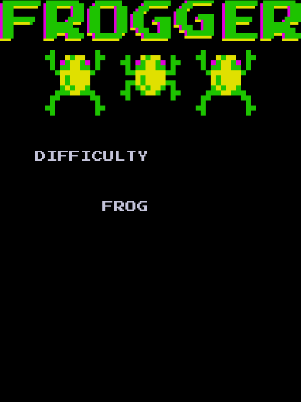
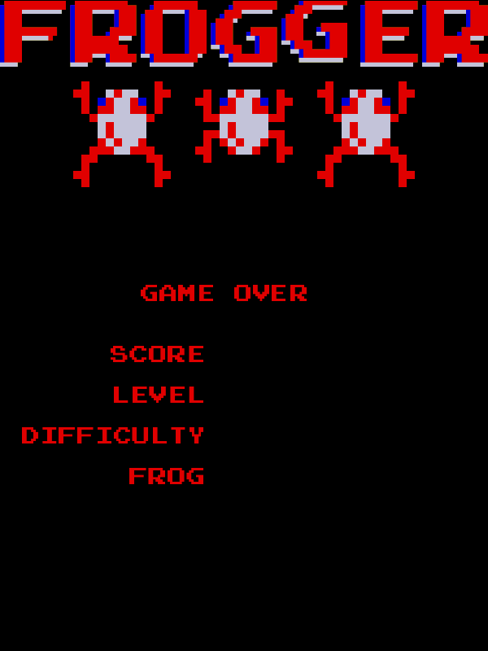

# Project Description
This repository contains a Java-based reimplementation of the legacy software: Frogger (1981), an arcade game that sees the player
navigate frogs to their homes. Additional features have also been included, notably different playable characters and
difficulties, alongside custom-made spritework for the title and game over screens.

# Frameworks
- Java 23
- JUnit
- JavaFX
- Gradle

# Screenshots

